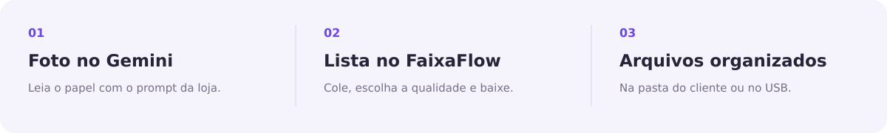
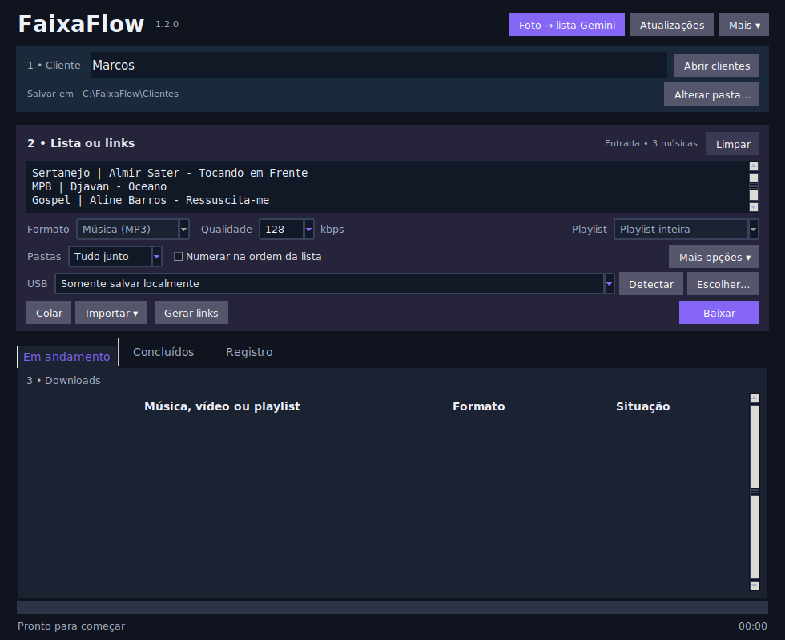

  

<a href="README.md">Português</a> · <a href="README.en.md">English</a> · <a href="README.es.md">Español</a>

<strong>Da lista ao pen drive.</strong> Windows · MP3 e MP4 · Fila de downloads · Organização por cliente

<a href="#download">Download</a> · <a href="#como-usar">Como usar</a> · <a href="CHANGELOG.md">Novidades</a> · <a href="SUPORTE.md">Suporte</a>

O **FaixaFlow** organiza o atendimento musical da sua loja. Cole a lista do cliente ou um link do YouTube, escolha o formato e baixe os arquivos para a pasta do cliente. Depois, copie para o pen drive.

Pode adicionar novas músicas e playlists à fila enquanto os downloads continuam.

## Download

<!-- release:start -->
**[Baixar para Windows (.exe)](https://github.com/themarcos2/faixaflow/releases/latest/download/FaixaFlow-Setup.exe)**

Versão **1.2.0** · Windows 10/11 de 64 bits · 133 MB
<!-- release:end -->

Baixe, execute o instalador e abra o FaixaFlow. O instalador ainda não possui assinatura digital.

## Como usar

1. Use o prompt do programa no Gemini para transformar a foto em uma lista.
2. Cole a lista no FaixaFlow e informe o nome do cliente.
3. Escolha a qualidade e a organização das pastas.
4. Clique em **Baixar** ou **Gerar links**.

Também aceita links de vídeos e playlists do YouTube, um por linha.

## Tudo em uma tela

- **Idioma:** português, inglês e espanhol, com detecção do Windows e escolha manual.
- **Áudio e vídeo:** MP3 de 128 a 320 kbps e MP4 de até 1080p.
- **Fila contínua:** adicione escolhas durante o atendimento.
- **Pastas organizadas:** por cliente, estilo, artista ou nome da playlist.
- **Ordem da lista:** numeração opcional para seguir o papel do cliente.
- **Pausar e continuar:** retome trabalhos interrompidos.
- **Entrega no pen drive:** copie os arquivos ao terminar.

## Importar listas

Além da lista do Gemini e dos links do YouTube, o menu **Importar** oferece arquivos TXT, CSV e JSON, Spotify e eSound. A importação do Spotify usa os nomes das faixas para buscar correspondências no YouTube.

## Ajuda

Consulte **Mais → Manual completo** ou o [guia de suporte](SUPORTE.md). Se precisar relatar um erro, use **Mais → Exportar diagnóstico**.

Use apenas conteúdos para os quais você tenha autorização.

FaixaFlow · Da lista ao pen drive.

