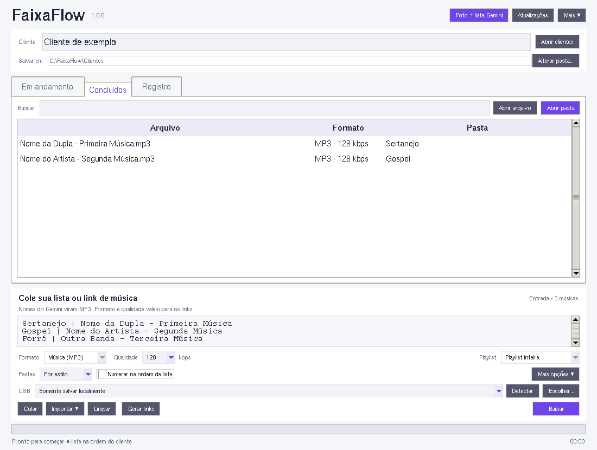
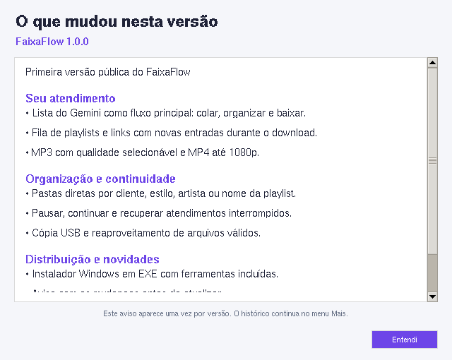

<p align="center">
  
</p>

<p align="center">
  <strong>O atendimento musical da sua loja, em uma única tela.</strong><br>
  Windows · MP3 e MP4 · Fila contínua · Pastas por cliente
</p>

<p align="center">
  <a href="#como-funciona">Como funciona</a> ·
  <a href="#veja-o-aplicativo">Veja o aplicativo</a> ·
  <a href="#download">Download</a> ·
  <a href="CHANGELOG.md">Novidades</a> ·
  <a href="SUPORTE.md">Suporte</a>
</p>

O **FaixaFlow** transforma a lista do cliente em um atendimento organizado.
Use o Gemini para ler a foto, cole os nomes no programa, escolha a qualidade e
acompanhe as músicas até a pasta do cliente ou o pen drive.

O cliente ainda está escolhendo? Você pode acrescentar playlists e links à fila
**enquanto o trabalho continua**, sem preparar todas as seleções de uma vez.

## Como funciona


1. Abra **Foto → lista Gemini** e copie o prompt da loja.
2. No Gemini, envie a foto e copie a lista padronizada.
3. Cole no FaixaFlow, informe o cliente e escolha qualidade e organização.
4. Clique em **Gerar links** ou **Baixar**. Ao concluir, use a opção de cópia USB.

```text
Sertanejo | Nome da Dupla - Primeira Música
Gospel | Nome do Artista - Segunda Música
Forró | Outra Banda - Terceira Música
```

O guia explica como conservar a ordem do papel, repetir artistas de um cabeçalho e
marcar trechos ilegíveis. O Gemini é usado no navegador; não precisa configurar uma API de IA.

## Veja o aplicativo


*Captura do aplicativo em ambiente de teste, com dados ilustrativos. Fontes e controles variam conforme o Windows.*

<details>
<summary><strong>Arquivos concluídos e janela de novidades</strong></summary>

<p>Encontre os arquivos concluídos, pesquise pelo nome e abra o arquivo ou a pasta.</p>


<p>As mudanças aparecem na primeira abertura de cada versão e continuam disponíveis no menu Mais.</p>


</details>

## O que acompanha o atendimento

| Você precisa… | O FaixaFlow oferece |
| --- | --- |
| Trabalhar a partir do papel | Lista do Gemini como fluxo principal, com estilo, artista e música |
| Acrescentar escolhas aos poucos | Fila de playlists e links individuais durante o download |
| Escolher o arquivo final | MP3 de 128 a 320 kbps; MP4 com teto de 360p, 480p, 720p ou 1080p |
| Entregar tudo organizado | Pastas por estilo, artista ou nome da playlist; numeração opcional |
| Continuar um atendimento | Pausar, retomar e recuperar trabalhos interrompidos |
| Encontrar os arquivos depois | Pastas diretas por cliente e destino lembrado |
| Evitar repetir trabalho | Reaproveitamento de arquivos locais válidos, conforme formato e qualidade |
| Resolver uma falha | Registro da operação e diagnóstico exportável para suporte |

A numeração começa desmarcada. A organização da lista do Gemini permanece disponível;
playlists prontas usam seu nome na subpasta do cliente.

## Download

<!-- release:start -->
**Primeiro lançamento em preparação.** O instalador Windows ainda precisa ser
compilado, validado e publicado. Quando estiver disponível, o download será
**FaixaFlow-Setup.exe** na seção [Releases](../../releases).
<!-- release:end -->

O instalador foi preparado para incluir Python, yt-dlp, FFmpeg, FFprobe e Deno.
O operador não precisa usar terminal ou compilar o aplicativo. Requer Windows 10/11 de 64 bits.

Este repositório reúne **apresentação, imagens e downloads**. O código do aplicativo
é mantido em um repositório privado separado.

## Atualizações que explicam o que mudou

Quando uma nova versão estiver publicada no canal configurado, o programa mostra
as mudanças e oferece **Atualizar agora** ou **Mais tarde**. Na primeira abertura
após instalar, aparece a janela **O que mudou**.

A documentação e os avisos são consultados dentro do aplicativo. O histórico
público começa em **1.0.0**; correções e novas funções recebem números proporcionais à mudança.

## Leveza como critério

Interface Tkinter nativa, sem navegador embutido. A tela não baixa capas ou
miniaturas. A conversão não aplica normalização de volume. O motor usa cache,
controle de solicitações e limites de processamento.

A velocidade depende da conexão, da máquina, do disco e da disponibilidade do
serviço de origem. A qualidade escolhida não recupera informação ausente na fonte.

<details>
<summary><strong>Outras entradas: Spotify, eSound e arquivos de lista</strong></summary>

O menu **Importar** reúne arquivos TXT/CSV/JSON, conexão Spotify e a opção eSound.
São recursos complementares ao atendimento por lista do Gemini.

Spotify importa informações das faixas por autorização da conta; não baixa o áudio
do Spotify. O eSound aceita os formatos públicos reconhecidos pelo leitor.
A disponibilidade depende das regras e do acesso permitido por cada serviço.

As sequências de links geradas para o YouTube não criam automaticamente uma playlist
permanente na conta Google.

</details>

## Precisa de ajuda?

Abra **Mais → Manual completo** ou siga o [guia de suporte](SUPORTE.md).
Para reportar uma falha, use **Mais → Exportar diagnóstico** e revise o conteúdo antes de compartilhar.

Use conteúdos para os quais você tenha autorização. O aplicativo não remove DRM.
O código próprio é privado; componentes de terceiros conservam suas licenças.

<p align="center"><sub>FaixaFlow · Da lista ao pen drive.</sub></p>
